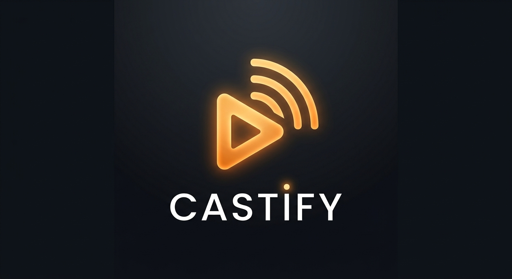

<div align="center">

  

  # 🎬 Castify — Tu Sala de Cine Digital

  **Una plataforma multimedia ligera, moderna y sin dependencias pesadas para streaming de TV en vivo, Radio, Podcasts y Listas M3U/M3U8 con soporte EPG.**

  [](https://developer.mozilla.org/es/docs/Web/JavaScript)
  [](https://tailwindcss.com/)
  [](https://github.com/video-dev/hls.js/)
  [](LICENSE)

  [Explorar Demo](#-demostración) • [Características](#-características-principales) • [Instalación](#-instalación-rápida) • [Arquitectura](#-arquitectura-del-proyecto)

</div>

---

## 📖 Acerca de Castify

**Castify** es una aplicación web progresiva (SPA) diseñada para ofrecer una experiencia cinematográfica fluida al consumir contenido multimedia en línea. Permite explorar emisoras de radio, podcasts y canales de televisión, además de importar listas de reproducción personalizadas (`.m3u` / `.m3u8`) con procesamiento automático de guías de programación **EPG (XMLTV)**.

Diseñada con un enfoque **Vanilla JS puro**, garantiza un rendimiento óptimo, tiempos de carga instantáneos y un consumo mínimo de recursos sin depender de frameworks pesados como React, Angular o Vue.

---

## ✨ Características Principales

- 📺 **Reproductor Multiformato Integrado**: Compatibilidad nativa y vía **HLS.js** para reproductores de vídeo MP4, MKV, TS y streams HLS (`.m3u8`).
- 📂 **Importador M3U / M3U8 Avanzado**:
  - Carga mediante URL pública (con *fallback* mediante proxy CORS).
  - Carga de archivos locales mediante selector o **Drag & Drop**.
- 📅 **Motor EPG (XMLTV)**:
  - Extracción automática de la URL de EPG (`url-tvg` / `x-tvg-url`) desde la cabecera `#EXTM3U`.
  - Mapeo de programación actual (*Now Playing*) y siguiente emisión por canal.
- 🎨 **Experiencia Cinematográfica**:
  - **Efecto Cinematic Dimmer**: Oscurece automáticamente la interfaz al reproducir vídeos.
  - **Film Grain Overlay**: Textura analógica opcional estilo grano de película.
- 🔍 **Búsqueda y Filtros en Tiempo Real**: Búsqueda instantánea por título, categoría, género o grupo dentro de las listas M3U.
- 📱 **Diseño Totalmente Responsivo**: Adaptado para escritorio, tablets y dispositivos móviles con menú lateral colapsable y barra flotante de reproducción.

---

## 🖥️ Demostración

```text
+-------------------------------------------------------------------------+
| [≡] Castify           [ Buscar canales... ]                (CS) Profile |
+-------------------------------------------------------------------------+
|  [Inicio]       |                                                       |
|  [TV Directo]   |   +-------------------------------------------------+ |
|  [Radio]        |   |                                                 | |
|  [Podcasts]     |   |               REPRODUCTOR CINEMÁTICO            | |
|  [Lista M3U]    |   |                                                 | |
|  [Ajustes]      |   +-------------------------------------------------+ |
|                 |   [ ► ] [ ◄◄ ] [ ►► ] [ 🔊 ===== ]    02:15 / 45:00   |
+-------------------------------------------------------------------------+
```
🚀 Instalación Rápida
Al no requerir compilación ni empaquetadores (Node.js/Webpack), desplegar Castify es rápido y sencillo.

1. Clonar el repositorio

``Bash
git clone [https://github.com/tu-usuario/castify.git](https://github.com/tu-usuario/castify.git)
cd castify
``
Con Node.js(Serve)
``Bash
npx serve .
``
Visita `http://localhost:8080` en tu navegador.

📁 Arquitectura del Proyecto
El proyecto sigue una arquitectura modular limpia orientada a objetos de configuración e instancias globales con responsabilidades únicas:
```Text
+----------------------------------------------------------------------------------------+
| castify/                                                                               |
| ├── index.html            # Estructura principal SPA y layouts de Tailwind             |
| ├── styles.css            # Estilos personalizados, animaciones y overlays             |
| ├── logo.jpg              # Logotipo de la aplicación                                  |
| ├── app.js                # Controlador principal (CinemaStream), PlayerEngine y datos |
| ├── playlist-ui.js        # Interfaz de usuario para la Playlist e importador M3U      |
| ├── epg-engine.js         # Motor de procesamiento XMLTV para la guía de programación  |
| └── m3u-parser.js         # Parser optimizado para metadatos #EXTINF y cabecera M3U    |
+----------------------------------------------------------------------------------------+
```

Módulos ClaveMóduloArchivoResponsabilidadCinemaStreamapp.jsControlador principal de la aplicación e inicializador SPA.PlayerEngineapp.jsGestión de eventos de reproducción HTML5/HLS, volumen y barra flotante.EPGEngineepg-engine.jsDescarga, parseo XMLTV y vinculación de horarios de programación EPG.PlaylistUIplaylist-ui.jsRenderizado por grupos, filtrado A-Z, búsqueda en listas e interacción.M3UParserm3u-parser.jsParsing eficiente de listas M3U/M3U8 y extracción de url-tvg.

⌨️ Atajos de Teclado del Reproductor
```Text
+-------------------------------------------------------------------------+
|              Tecla            |                   Acción                |
+-------------------------------------------------------------------------+
|   Espacio                     | Reproducir / Pausar                     |
|   ← / →                       | Canal anterior / Canal siguiente        |
|   Alt + ← / →                 | Retroceder / Avanzar 10 segundos        |
|   M                           | Silenciar / Activar sonido              |
|   F                           | Alternar pantalla completa              |
|   C                           | Activar / Desactivar modo cine (Dimmer) |
+-------------------------------------------------------------------------+
```
## 🛠️ Tecnologías Utilizadas

Castify ha sido desarrollada con tecnologías web modernas, ligeras y con rendimiento nativo en el navegador, sin necesidad de frameworks pesados:

[](https://developer.mozilla.org/en-US/docs/Web/HTML)
[](https://developer.mozilla.org/en-US/docs/Web/CSS)
[](https://tailwindcss.com/)
[](https://developer.mozilla.org/es/docs/Web/JavaScript)
[](https://github.com/video-dev/hls.js/)
[](https://git-scm.com/)

📄 Licencia
Este proyecto está bajo la Licencia MIT. Consulta el archivo LICENSE para más detalles.
